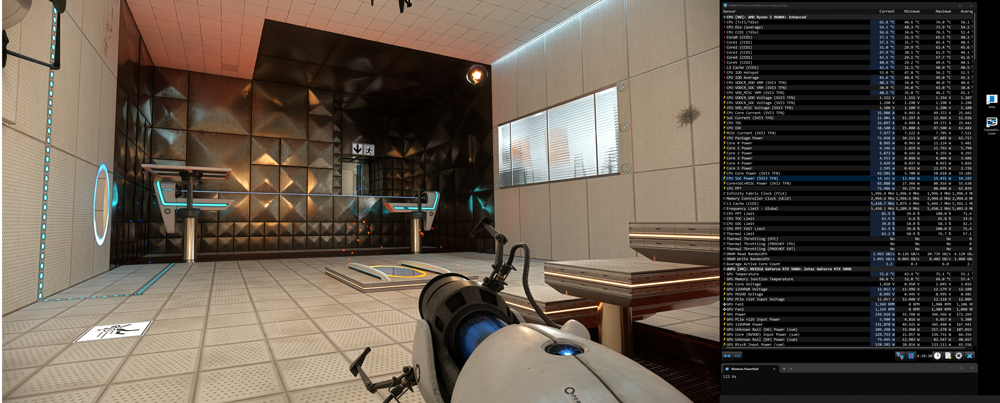

# NVIDIA VRR Monitor (PowerShell)

**Version 0.2.1**

A lightweight Windows PowerShell utility for OLED monitor owners who want a refresh-rate indicator without keeping an OSD or software overlay on the game display. It reads NVIDIA NVAPI presentation data and estimates the display refresh rate in a separate console window.

The goal is deliberately simple: glance at a secondary display and see a refresh-rate number, much like the refresh-rate OSD indicators enthusiasts have used with variable-refresh-rate monitors for years, but without having to display the OSD on the actual OLED panel. 

## Screenshot



## What's new in v0.2.1

This is the first public release to include the compact display and simplified output modes. Version 0.2.0 was an unpublished development build.

- **Compact Standard view:** shows a simple, rounded refresh-rate estimate (for example, `142 Hz`) without the diagnostic telemetry.
- **Optional Verbose view:** use `-VerboseOutput` to see rolling average, median, flip age, and NVAPI diagnostic information.
- **Improved logging documentation:** Log mode prints each periodic reading on its own line; CSV files retain the full diagnostic dataset in either console view.
- **Built-in PowerShell help:** use `Get-Help .\\VrrMonitor.ps1` for usage and examples.

## Features

- **Standard view:** a minimal, whole-number refresh-rate estimate (for example, `142 Hz`).
- **Verbose view:** rolling average, median, time since the last flip, NVAPI status codes, and VRR flags when available.
- **CSV logging:** always records the verbose diagnostic dataset, even when the console uses Standard view.
- **Readable log output:** Log mode prints one reading per line at the configured update cadence (500 ms by default), creating a simple refresh-rate history in the terminal.
- No in-game overlay and no administrator privileges required.
- JSON configuration for the target NVAPI display ID and sampling behavior.

## Requirements

- Windows 10 or Windows 11
- 64-bit Windows PowerShell 5.1 or PowerShell 7
- NVIDIA GPU and installed NVIDIA display driver
- `nvapi64.dll` supplied by the NVIDIA driver

## Configure

Copy `vrr-monitor.config.example.json` to `vrr-monitor.config.json` and set `DisplayId` to the NVAPI display ID for the monitor you want to observe. This is not necessarily the same as the Windows display number. Do not commit your personal config.

## Run

Standard view (default):

```powershell
.\VrrMonitor.ps1
```

Verbose view:

```powershell
.\VrrMonitor.ps1 -VerboseOutput
```

Log to CSV, with a minimal console display:

```powershell
.\VrrMonitor.ps1 -Mode Log
```

Log to CSV and show verbose console details:

```powershell
.\VrrMonitor.ps1 -Mode Log -VerboseOutput
```

Stop monitoring with `Ctrl+C`. Log mode writes a timestamped CSV beside the script. The CSV always contains the verbose diagnostic fields regardless of the console view. In Standard Log mode, each periodic reading appears on its own new line (for example, `142 Hz`, then `139 Hz`). These are periodic samples at the configured update cadence (500 ms by default), not individual GPU flip events. Verbose Log mode prints the same samples with diagnostic details.

In Standard Log mode, each periodic reading is printed on its own new line (for example, `142 Hz`, then `139 Hz`). This is one sample per configured display update—not one line per individual GPU flip. The default update cadence is 500 ms and can be changed with `UpdateIntervalMs` in the config. Verbose Log mode prints the same periodic samples with diagnostic details.

The switch is named `-VerboseOutput` because PowerShell already reserves `-Verbose` as a common parameter.

### Built-in help

The script includes PowerShell comment-based help. Use either of these from the script directory:

```powershell
Get-Help .\VrrMonitor.ps1
Get-Help .\VrrMonitor.ps1 -Detailed
```

PowerShell's built-in `-?` help switch is also available:

```powershell
.\VrrMonitor.ps1 -?
```

If script execution is blocked by the current execution policy, avoid changing the machine-wide policy. In the current PowerShell window, use a process-scoped setting:

```powershell
Set-ExecutionPolicy -Scope Process -ExecutionPolicy Bypass
```

## Configuration fields

| Field | Meaning |
|---|---|
| `DisplayId` | NVAPI display ID for the monitor |
| `WindowSeconds` | Rolling window used for the refresh-rate estimate |
| `UpdateIntervalMs` | Console update cadence |
| `PollIntervalMs` | Delay between NVAPI polls |
| `StartupDelaySeconds` | Time to switch focus to the game before sampling begins |
| `LogFile` | Base name for timestamped CSV files |

## Understanding the estimate

The refresh-rate estimate is calculated from changes in NVAPI AdaptiveSync flip timestamps and `LastFlipRefreshCount`. The displayed Standard value is the rounded weighted rolling average. Verbose view also shows the rolling median and time since the last observed flip.

**This is an estimate, not a direct measurement from the panel's timing controller.** It can be affected by driver behavior, presentation mode, polling cadence, and whether new flips are occurring. If no recent flip data is observed, the display reports that rather than presenting a stale rate. A low or changing estimate is useful evidence of variable-refresh behavior, but is not definitive proof that G-SYNC/VRR is engaged.

The separate NVAPI VRR Info query is retained for diagnostics. If it fails, its flags are recorded as unavailable—not as `False`. A failed VRR Info query does not invalidate a successful AdaptiveSync refresh estimate.

## Security

- The embedded C# wrapper loads `nvapi64.dll` from the Windows System32 directory using `LoadLibraryEx` with `LOAD_LIBRARY_SEARCH_SYSTEM32`.
- The script does not require administrator privileges.
- No network access or external PowerShell modules are required.

## Compatibility notes

The NVAPI function IDs and structure layouts are NVIDIA driver interfaces and may vary in behavior across driver versions and display configurations. The refresh-rate estimate has been tested on a limited set of hardware and should be treated as experimental. Contributions and compatibility reports are welcome.
